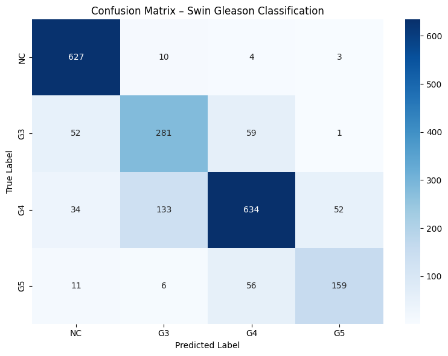
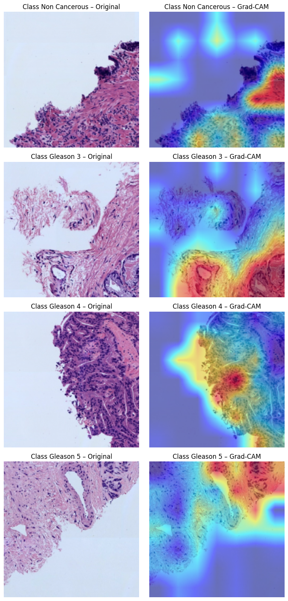

# Gleason Grade Classification with Vision Transformers

Patch-level prostate cancer grading on the SICAPv2 histopathology dataset. We compare a fine-tuned **VGG-16** CNN baseline with three transformer models: a **ViT trained from scratch**, a **pretrained ViT-B/16**, and a **Swin Transformer**. Grad-CAM shows which tissue regions each model relies on.

Course project, Toronto Metropolitan University (MSc Computer Science). Full write-up: [`report/Gleason_Grade_Classification.pdf`](report/Gleason_Grade_Classification.pdf)

## Results (SICAPv2 test set, 2,122 patches)

| Model | Accuracy | Macro F1 | Macro AUC (OvR) | QWK |
|---|---|---|---|---|
| ViT trained from scratch | 0.476 | 0.473 | 0.815 | 0.604 |
| VGG-16 (ImageNet, fine-tuned) | 0.777 | 0.741 | 0.937 | 0.791 |
| ViT-B/16 (ImageNet, fine-tuned) | 0.722 | 0.671 | 0.907 | 0.797 |
| **Swin-B (ImageNet-22k, fine-tuned)** | **0.802** | **0.775** | **0.949** | **0.851** |

QWK (quadratic weighted kappa) rewards predictions that are close to the true grade, so confusing G3 with G4 costs less than confusing NC with G5.

**Key findings**
- Transfer learning is essential: the same ViT architecture went from QWK 0.60 (from scratch) to 0.80 (pretrained).
- Swin performed best on every metric.
- Most errors are between neighbouring grades (G3 vs G4, G4 vs G5). G5 is the hardest class: it is only 7.2% of the training data and looks similar to G4.
- Grad-CAM shows the pretrained models mostly focus on cancerous tissue regions.




## Team and contributions

| Team member | Part |
|---|---|
| Ishraq Quayyum | VGG-16 CNN baseline (`models/vgg16/`) |
| Ali Navab Zadeh | ViT from scratch and pretrained ViT-B/16 (`models/vit/vit-from-scratch-and-pretrained-b16.ipynb`) |
| Parthraj Veluri | Swin Transformer (`models/swin/`) |

## Dataset

[SICAPv2](https://data.mendeley.com/datasets/9xxm58dvs3/1): prostate histopathology patches (224 × 224 after resizing) labelled NC, G3, G4, G5 (G4C is merged into G4). The dataset is **not included** in this repo. Download it and keep the original folder layout:

```
SICAPv2/
├── images/
└── partition/Test/
    ├── Train.xlsx   # 9,959 patches
    └── Test.xlsx    # 2,122 patches
```

Class counts (training set): NC 3,773 · G3 1,829 · G4 3,641 · G5 716.

## Repository structure

```
gleason-grade-classification/
├── models/
│   ├── vgg16/CNN.py                                  # VGG-16 baseline (TensorFlow / Keras)
│   ├── vit/vit-from-scratch-and-pretrained-b16.ipynb # ViT scratch + ViT-B/16 (TensorFlow / Keras)
│   └── swin/Swin_Torch.ipynb                         # Swin Transformer (PyTorch)
├── report/
│   ├── Gleason_Grade_Classification.pdf
│   ├── gleason_report.tex
│   └── Images/                                       # figures used in the report
└── README.md
```

## How to run

All models need a GPU. We ran them on Kaggle (free GPU), which is the easiest option: create a notebook, click **Add Input**, and add the SICAPv2 dataset.

### 1. ViT from scratch and pretrained ViT-B/16 (TensorFlow)
1. Open `models/vit/vit-from-scratch-and-pretrained-b16.ipynb` on Kaggle (or Colab) with a GPU.
2. Add the SICAPv2 dataset and set `SICAP_ROOT` in the data cell to where it is mounted (default: `/kaggle/input/SICAPv2`).
3. The notebook installs what it needs: `pip install vit-keras scikit-learn seaborn`.
4. Run all cells. It builds the 80/20 train/validation split, computes balanced class weights, trains the scratch ViT, then fine-tunes ViT-B/16 in two stages (frozen backbone, then the last layers unfrozen), and finally prints metrics, confusion matrices, ROC curves, and Grad-CAM maps.

### 2. VGG-16 baseline (TensorFlow)
1. Install: `pip install tensorflow pandas openpyxl scikit-learn matplotlib seaborn`
2. In `models/vgg16/CNN.py`, set `BASE_DIR` to your SICAPv2 folder and `OUTPUT_DIR` to where results should go. Set `DEBUG_MODE = False` (or `True` for a quick 3-epoch test on 100 images).
3. Run `python models/vgg16/CNN.py`. It fine-tunes VGG-16 for up to 100 epochs with early stopping, then evaluates with and without test-time augmentation and saves the confusion matrix, training curves, and a results summary to `OUTPUT_DIR`.

### 3. Swin Transformer (PyTorch)
1. Open `models/swin/Swin_Torch.ipynb` on Kaggle with a GPU (Colab works but took 5 to 6 hours to train; Kaggle took about 30 minutes).
2. Install: `pip install timm pytorch-lightning torchmetrics grad-cam`
3. Set `SICAP_ROOT` to the dataset location.
4. Run all cells. The backbone is `swin_base_patch4_window7_224.ms_in22k_ft_in1k` from `timm`. Training has two stages: first only the classifier head, then the last two stages of the backbone are unfrozen. To evaluate without retraining, point the checkpoint path in the evaluation cell to your saved `.ckpt` file.

## Limitations
- The train/validation split is at the **patch level**, not the patient level, so patches from the same patient can appear in both. Validation scores may be optimistic. A patient-level split would give a stricter estimate.
- Results come from one run per model; we did not report variance across random seeds.
- This is a research comparison, not a clinical tool. Any automated grading system would need extensive validation and should support, not replace, a pathologist.

## References
- Dosovitskiy et al., *An Image is Worth 16x16 Words: Transformers for Image Recognition at Scale*, ICLR 2021.
- Liu et al., *Swin Transformer: Hierarchical Vision Transformer using Shifted Windows*, ICCV 2021.
- Selvaraju et al., *Grad-CAM: Visual Explanations from Deep Networks via Gradient-based Localization*, ICCV 2017.
- Silva-Rodríguez et al., *Going deeper through the Gleason scoring scale: An automatic end-to-end system for histology prostate grading and cribriform pattern detection* (SICAPv2), Computer Methods and Programs in Biomedicine, 2020.
